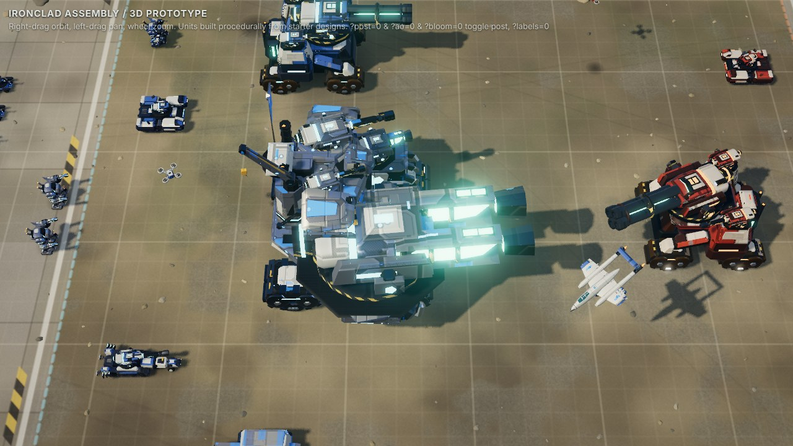
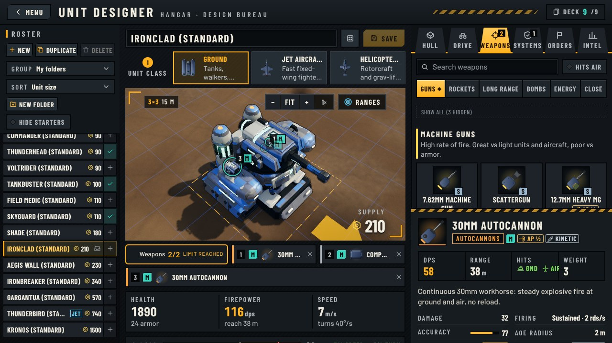
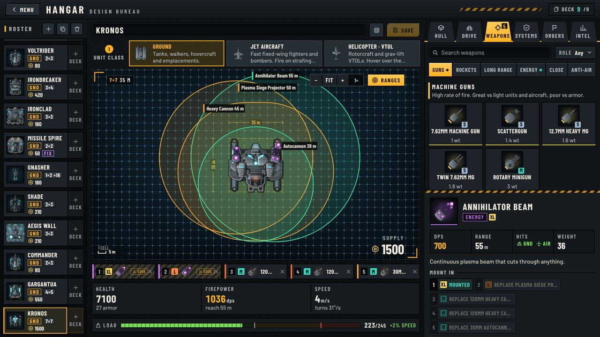
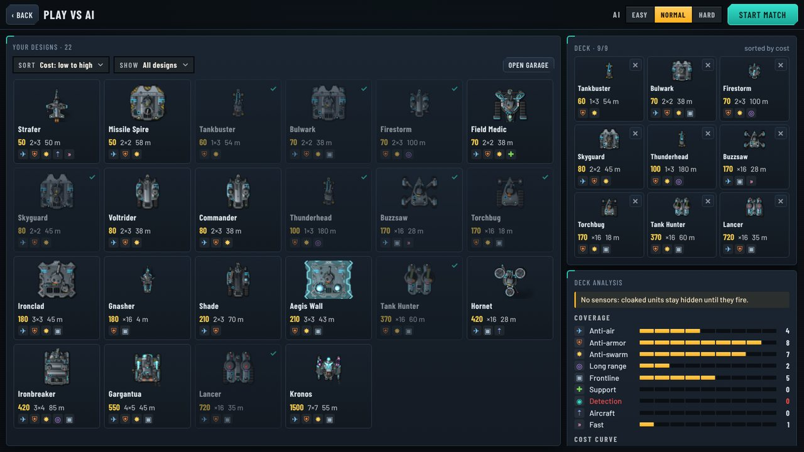
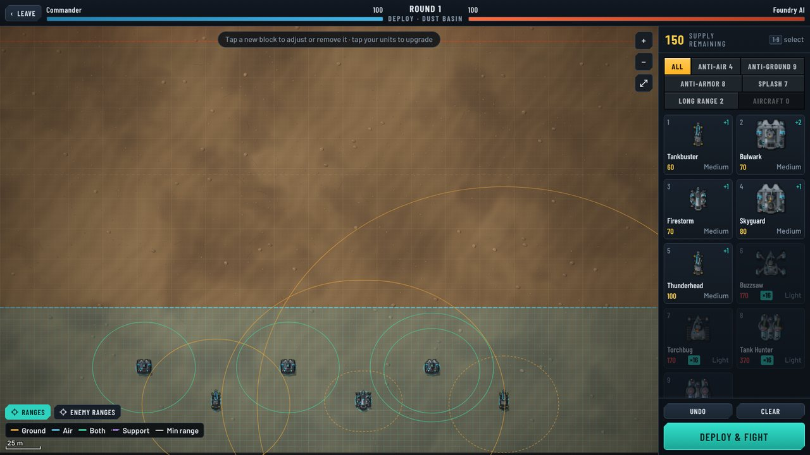
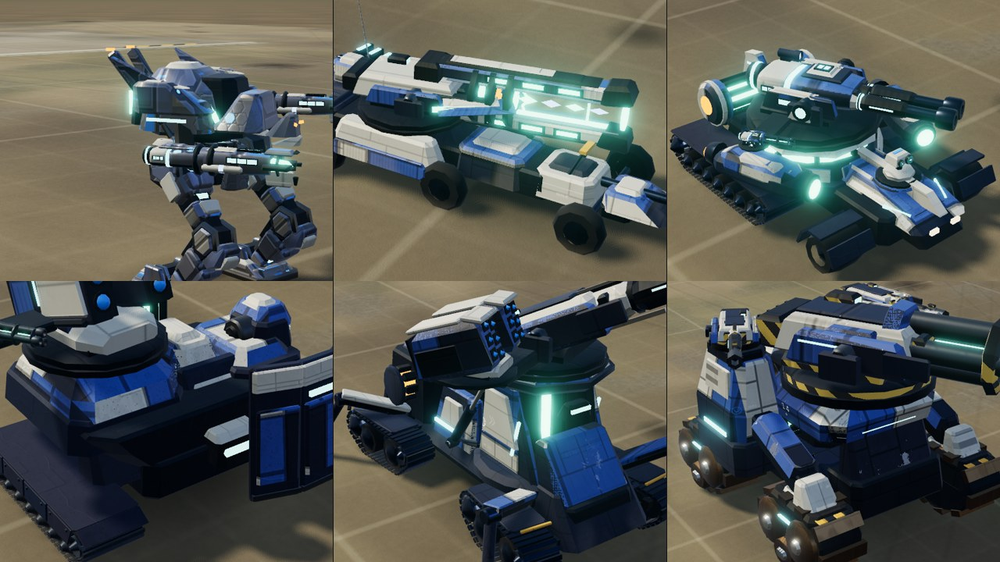
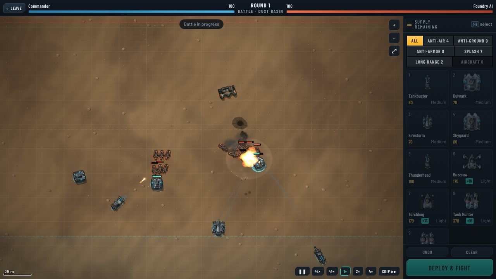
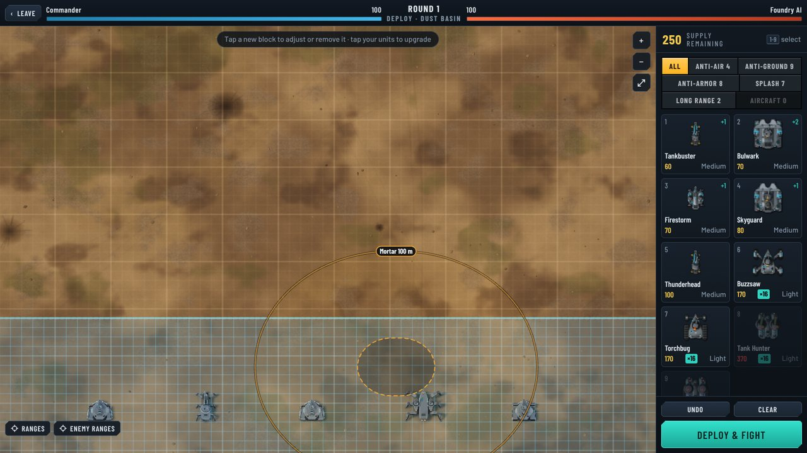

# Ironclad Assembly

A browser autobattler in the spirit of **Mechabellum**, where you **design your own units from parts**
(like *Echoes of the Architect*). Play against the AI, or play **async multiplayer** against other
players: each of you deploys whenever you like, and the server resolves the round once both have.



## Screenshots

| Unit designer | Weapon ranges in the designer |
|---|---|
|  |  |
| **Deck builder (vs AI)** | **Deploying, with ranges shown** |
|  |  |

## 3D units

Every unit is modelled procedurally in three.js from its part design: the hull is built around its main weapon,
secondary weapons ride the main system, mechs twist their whole torso with their arm guns, and every weapon family
has its own year-2500 look. How it works and the art rules: [docs/3d-units-guide.md](docs/3d-units-guide.md).



## 2D and 3D battlefield

The battlefield is 3D by default (three.js, needs WebGL). Settings → **Battlefield art** switches to the classic
hand-drawn 2D view. The designer and the rest of the UI are the same in both.

| 2D | 3D |
|---|---|
|  |  |
|  |  |

## Run

```bash
npm install
npm start          # builds the client and serves it + the API on http://localhost:8080
```

`PORT`, `DATA_DIR` (default `./data`) and `TRUST_PROXY` configure the server. `npm test` runs the test
suite, `npm run typecheck` checks types. `public/artlab.html` (after `npm run build`) shows every part
and a demo battle.

## Deploy (Fly.io)

`fly.toml` and the `Dockerfile` are ready. One-time setup, from the repo root:

```bash
fly launch --no-deploy --copy-config     # pick a free app name (edit `app` in fly.toml) and a region
fly volumes create ironclad_data --size 1 --region iad   # same region as primary_region in fly.toml
fly deploy
```

After that, `fly deploy` ships each update. Players and async PvP matches are JSON files on the
`ironclad_data` volume, so run exactly one machine (`fly scale count 1`); a second machine would get its own
volume and its own copy of the data. The machine sleeps when idle and wakes on the next request; the server
saves its data on shutdown, so nothing is lost. Health check: `GET /api/health`.

## How it plays

1. **Garage** — build designs from parts on a blueprint bench drawn on the true 5 m grid: drag weapons and modules
   straight onto the sockets on the robot (drag between sockets to swap, off the robot to remove), and browse parts in
   Hull / Drive / Weapons / Systems / Orders / Intel tabs with a spec-sheet inspector:
   - **10 chassis** (sizes 1×1, 2×2, 3×3; 1–4 mount slots of class L/M/H): Scout, Drone Core, Raider,
     Warden, Striker, Longarm, Aegis, Gunship, Bastion, Colossus.
   - **10 mobility systems**: wheels, half-track, tank treads, biped legs, spider legs, jump legs,
     hover skirt, rotor (heli), jet thrusters, anchor (static emplacement). Not every mobility fits every
     chassis (size limits; the Gunship must fly).
   - **82 modules**: 54 weapons in 12 categories (machine guns, autocannons, cannons, sniper & rail,
     rockets, missiles, artillery, energy, flame, stun & disruption, flak, melee) with sub-variants such as
     30mm vs Twin 30mm; plus 25 utilities (shields, shield dome, point defense, smoke, reactive armor,
     stealth & phantom cloaks, ECM, sensors, engines, gyro, autoloader, overclock, self-destruct…) and armor.
     A slot accepts its own class or smaller, and you can fill slots with utilities only.
   - **Weight vs capacity** sets speed (up to +25% when light, crawling when overloaded, illegal past 150%).
   - Weapons differ in firing pattern (sustained, clip + reload, salvo, single shot) and accuracy:
     beams/rails never miss, missiles home, and every other projectile leads its target (aims where a target on
     its current course will be when the round arrives). Slow artillery shells and rockets can still be slipped
     by a target that changes course mid-flight; turrets only fire once aligned.
2. **Deck** — bring up to 9 designs into a match.
3. **Rounds** — each round you get supply (300, +50/round, unspent carries over), buy units from your deck
   and place them on your half of the grid, or upgrade units you already own (up to level 3). Placements
   are secret until both sides commit; placed units persist and redeploy every round.
4. **Battle** — fully automatic and deterministic. The loser takes damage based on the enemy's surviving
   units. Start at 100 HP; reach 0 and you lose.

### Tug of War

A real-time mode (menu → **Tug of War**), against the AI (easy / normal / hard) or another person online (quick
match, or a private game with a join code). One endless battle on its own field: half the standard width and a
quarter longer (240 m x 575 m), with a shallower deploy zone per side. Each side has a castle at its back edge and
earns gold every second. Spend it on blocks from your **tug roster** (up to 9 designs, kept separately from the
Loadout deck) and drop them anywhere in your deploy zone while the fight runs. After a 5 s spawn time (frozen where
they landed, though their guns already fire) they march straight up their lane, fight anything
that comes within reach and shell the enemy castle once they get there. Gold can also be **invested** in a higher
income rate or spent to **unlock the next hull tier** (Light and Medium to start, then Heavy, Giant, Titan). Destroy
the enemy castle to win; from 10:00, overtime crumbles both castles so every game ends.

Keys: `1`–`9` pick a roster card, click to drop, `R` turns a squad, `I` invests, `U` unlocks the next tier, `Esc`
cancels. Online games are lockstep: the server stamps every command with a tick ~0.8 s ahead and both clients run the
same deterministic sim up to the server's frontier (`src/shared/tug.ts`, `src/server/tug.ts`).

### Unit cost

A design's cost is not just the sum of its parts. `src/shared/stats.ts` predicts each unit's
**offense** (dps vs a mix of armor, × splash/chain/burn/stun value, × range, × accuracy, × target
coverage) and **effective HP** (hp, shields, armor, evasion, cloaks, flight…), then prices it by
`sqrt(offense × ehp)` (Lanchester's square law) plus a share of parts complexity — so equal-supply
armies are balanced whatever their composition. `scripts/balance.ts` checks this by fighting
equal-cost armies for every module.

A **toughness floor** ("wall tax", `TOUGH` in `stats.ts`) charges very tough hulls for their raw toughness
(hp × armour + shields above ~3000, on a concave curve) when their bare hull is priced below it, with guns on them
counted at half: a weaponless 13k-hp Monolith wall costs ~450, not 180. Ordinary hulls are untouched.
Prices are monotone: adding a part never makes a design cheaper (a design costs at least as much as any of its
sub-designs). The analytic price treats a unit as if it fought alone; `scripts/teamvalue.ts` measures what designs
are worth as part of an army (WAR / RAPM style: context armies, a stock filler as replacement level, Shapley-shared
synergy, `mean + 0.5·(P80 − mean)` over contexts) and fits a correction `analytic × exp(Σ β·features)`
(`TEAM_FIT` in `stats.ts`). That correction ships **off** (`TEAM_VALUE.on = false`); it is tooling for now.

## Code map

| Path | What |
| --- | --- |
| `src/shared/parts.ts` | Part catalog (chassis, mobility, modules, categories) |
| `src/shared/stats.ts` | Design → stats, validation, cost model |
| `src/shared/sim/` | Deterministic battle simulation (fixed 20 Hz tick, seeded RNG) |
| `src/shared/match.ts` | Match rules: rounds, supply, deployment validation, damage, redaction |
| `src/shared/tug.ts`, `tugai.ts` | Tug of war rules (economy, castles, drop zone, commands) and its AI |
| `src/shared/ai.ts`, `starters.ts` | AI decks/deployment (hard mode simulates candidates), starter designs |
| `src/server/` | Async multiplayer HTTP API + JSON persistence + static hosting; `tug.ts`: real-time tug of war rooms (lockstep clock) |
| `src/client/render/` | Procedural part-based unit art, effects, part icons |
| `src/client/audio.ts` | Synthesized SFX + music |
| `src/client/ui/` | Menu, garage, lobby, vs-AI, match (deploy + battle replay), settings |

## Credits

See [CREDITS.md](CREDITS.md).
